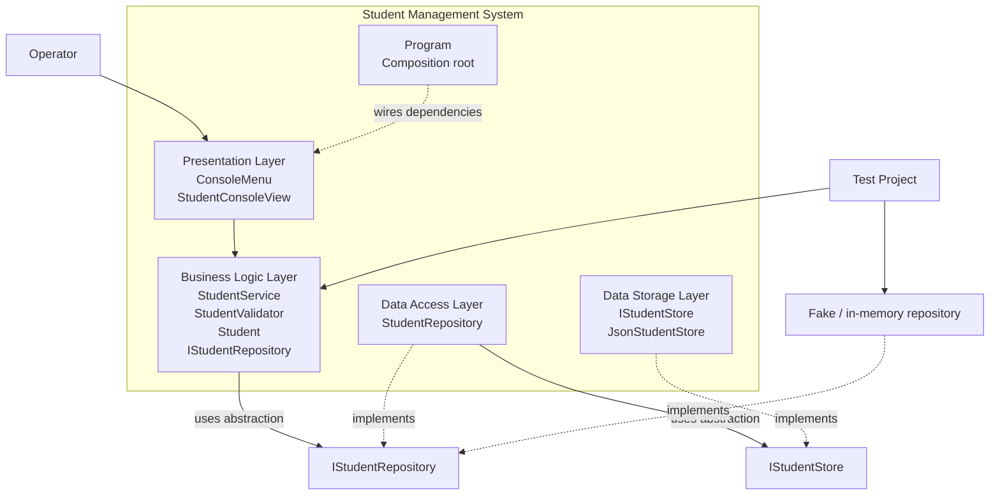

# Student Management System — Architecture

## 1. Project Architecture Overview

This document proposes a simple layered architecture for the .NET 10 console application, based on the functional and non-functional requirements in [REQUIREMENTS.md](./REQUIREMENTS.md). The design supports adding, listing, searching, updating, and deleting students while keeping validation, console interaction, and persistent storage separate.

For the first version, keep the application in one .NET project organized into folders and use a separate test project. This avoids unnecessary project complexity while preserving boundaries that can later be split into separate projects.



The solid arrows show runtime calls; the dotted arrows show dependency registration or implementation relationships. `IStudentRepository` belongs to the Business Logic Layer because that layer defines the data operations it needs. `StudentRepository` implements it in the Data Access Layer. The storage contract separates repository operations from a file or database implementation.

## 2. Layer-Wise Responsibilities

### Presentation Layer

- Displays the menu and reads keyboard input.
- Collects student details and requests confirmation before deletion.
- Calls business use cases and formats their results for the console.
- Reports invalid menu choices and presents clear success, empty-result, and error messages.
- Does not enforce student business rules or read/write storage directly.

### Business Logic Layer

- Implements student use cases and business rules.
- Validates required fields and agreed field-specific constraints.
- Enforces student ID uniqueness for adds and ID changes.
- Coordinates repository calls and ensures an invalid update does not replace the existing record.
- Does not depend on console APIs, file formats, or database APIs.

### Data Access Layer

- Implements the repository contract required by the Business Logic Layer.
- Retrieves and changes student records through the storage contract.
- Translates between application-level student operations and the selected storage representation when needed.
- Reports failures; it must not claim a change succeeded if it was not persisted.

### Data Storage Layer

- Reads and writes durable student data.
- Owns storage-specific details such as serialization, file paths, and database APIs.
- Preserves existing data and reports read/write failures rather than silently treating bad or unreadable data as an empty collection.

## 3. Component Descriptions

| Component | Layer | Description |
|---|---|---|
| `Program` | Composition root | Configures dependencies and starts the console application. It is the one place that selects concrete implementations. |
| `ConsoleMenu` | Presentation | Shows menu options, routes selections to use cases, and continues the interaction loop when appropriate. |
| `StudentConsoleView` | Presentation | Prompts for student details and formats student records, confirmations, and messages. |
| `Student` | Business Logic | Represents a student and the fields agreed for the application. The exact fields remain an open requirement decision. |
| `StudentService` | Business Logic | Coordinates add, list, search, update, and delete use cases and enforces business rules. |
| `StudentValidator` | Business Logic | Applies required-field and agreed format, length, and range rules consistently for adds and updates. |
| `IStudentRepository` | Business Logic | Defines the student data operations required by `StudentService`, independent of storage technology. |
| `StudentRepository` | Data Access | Implements `IStudentRepository` and coordinates retrieval and changes through `IStudentStore`. |
| `IStudentStore` | Data Storage | Defines the basic persistence operations used by `StudentRepository`, such as loading and saving student records. |
| `JsonStudentStore` | Data Storage | A proposed initial `IStudentStore` implementation using a JSON file. It is an option, not a finalized storage decision. |

Expected business outcomes such as invalid information, duplicate ID, or missing student should be returned to the caller in a consistent, explicit way. Unexpected operational failures, especially storage failures, should be surfaced as errors and must not be converted into success-shaped results.

## 4. Class Responsibility Matrix

| Class / contract | Main responsibility | Must not be responsible for |
|---|---|---|
| `Program` | Build the dependency graph and start the application. | Student validation or record-management workflows. |
| `ConsoleMenu` | Present menu choices and dispatch user actions. | File access or student ID uniqueness rules. |
| `StudentConsoleView` | Read and format console input/output. | Persisting records or deciding whether a student is valid. |
| `Student` | Represent the student data used by the application. | Console prompting or storage file handling. |
| `StudentService` | Coordinate use cases, validation, uniqueness checks, and repository calls. | Console formatting or JSON serialization. |
| `StudentValidator` | Validate student field values using agreed business constraints. | Reading input directly or saving records. |
| `IStudentRepository` | Declare data operations needed by the business layer. | Exposing storage implementation details. |
| `StudentRepository` | Implement repository operations using the storage boundary. | Displaying messages to the user. |
| `IStudentStore` | Declare low-level persistence operations for the repository. | Student-facing interaction or menu decisions. |
| `JsonStudentStore` | Load and save the selected JSON data representation. | Business workflow or console output. |

## 5. Application Execution Flow

1. The runtime starts `Program`.
2. `Program` creates/configures the dependency-injection container and registers the menu, services, repository, and chosen store implementation.
3. The application loads or verifies existing data before allowing changes. If existing data cannot be read, it reports the problem and does not silently replace it with an empty set.
4. `ConsoleMenu` displays the available operations and accepts a selection.
5. The menu delegates the selected operation to `StudentService`, collecting any required input through `StudentConsoleView`.
6. `StudentService` validates input and applies business rules, then calls `IStudentRepository`.
7. `StudentRepository` uses `IStudentStore` to retrieve or persist records.
8. The result returns to the presentation layer, which shows a clear outcome and returns to the menu when safe.
9. The application exits when the user selects the exit option or otherwise ends the console session.

## 6. Student Registration Flow

The registration path implements FR-001, FR-006, and FR-007. The student ID comparison rule must be consistent across registration, search, and update; its case and whitespace behavior remains a decision to confirm.

```mermaid
sequenceDiagram
    actor User as Operator
    participant Menu as ConsoleMenu
    participant View as StudentConsoleView
    participant Service as StudentService
    participant Validator as StudentValidator
    participant Repo as StudentRepository
    participant Store as JsonStudentStore

    User->>Menu: Select Add Student
    Menu->>View: Request student details
    View->>User: Prompt for ID and required details
    User->>View: Enter details
    View-->>Menu: Student input
    Menu->>Service: Add student
    Service->>Validator: Validate student information
    Validator-->>Service: Validation result

    alt Input is invalid
        Service-->>Menu: Validation failure
        Menu->>View: Display field-specific guidance
        View-->>User: Show error; offer correction
    else Input is valid
        Service->>Repo: Find by proposed student ID
        Repo->>Store: Load/read student records
        Store-->>Repo: Existing records
        Repo-->>Service: Match or no match

        alt Student ID already exists
            Service-->>Menu: Duplicate ID failure
            Menu->>View: Display duplicate-ID message
            View-->>User: Explain ID must be unique
        else Student ID is unused
            Service->>Repo: Add validated student
            Repo->>Store: Persist updated records
            Store-->>Repo: Save result
            Repo-->>Service: Add result
            Service-->>Menu: Success after persistence
            Menu->>View: Display confirmation
            View-->>User: Show successful registration
        end
    end
```

If a storage read or write fails, the operation must return a failure and the presentation layer must not show a successful registration. The proposed JSON-file implementation is intended for a simple single-user application. If concurrent writers or multiple application instances become a requirement, uniqueness checking and saving must be made atomic, typically with a storage-level unique constraint or equivalent transaction.

## 7. Data Storage Strategy

The requirements require persistence across application restarts but do not select a storage technology or data location. For an initial single-user version, a JSON file is a straightforward option:

- Store the collection of student records in a documented application data location, not in an accidental current working directory.
- Load existing records when the application starts; do not silently initialize an empty collection if existing data is unreadable or malformed.
- Persist a successful add, update, or delete before reporting success.
- Use a safe write approach, such as writing a temporary file and replacing the previous file only after the new content is complete, to reduce the chance of partial data.
- Report storage errors clearly and retain/recover the previous data where possible.
- Document the data location and backup/recovery expectations before release.

`IStudentStore` and `StudentRepository` keep storage operations isolated so a database implementation can replace JSON later without changing the user workflow or business rules. The proposed JSON choice should be confirmed before implementation.

## 8. Dependency Injection Strategy

Use constructor injection so components receive the dependencies they need rather than creating concrete dependencies internally:

- `ConsoleMenu` receives `StudentService` and `StudentConsoleView`.
- `StudentService` receives `IStudentRepository` and `StudentValidator`.
- `StudentRepository` receives `IStudentStore`.
- `Program` registers and connects the concrete implementations, such as `StudentRepository` for `IStudentRepository` and `JsonStudentStore` for `IStudentStore`.

The .NET dependency-injection container should be configured only in the composition root. A small first version may create dependencies explicitly there; if using the built-in Microsoft.Extensions container, add the appropriate `Microsoft.Extensions.DependencyInjection` or Generic Host package. Business classes should not resolve dependencies from the container themselves.

## 9. Error Handling Strategy

- **Invalid menu or console input:** Presentation rejects it with a clear message and offers another attempt where appropriate.
- **Invalid student fields:** `StudentValidator` returns field-specific validation information; the service does not save invalid data.
- **Duplicate ID or missing student:** The service returns a clear expected outcome; the presentation layer explains it without exposing implementation details.
- **Read/write failure:** The storage layer reports the failure to its caller; repository and service preserve the failure outcome. The application does not report success or silently discard data.
- **Unexpected failure:** Handle it at an appropriate application boundary, provide a safe user-facing message, and record diagnostics if logging is configured. Do not silently catch and ignore exceptions.
- **Failed update:** Validate before saving and ensure the previous record remains unchanged if validation or persistence fails.
- **Recoverable error:** Return the operator to a usable menu or prompt when it is safe to continue.

Expected validation and not-found outcomes are normal application behavior and should not require broad exception handling. Exceptions are appropriate for unexpected operational failures; if typed exceptions are selected for expected outcomes, use them consistently and handle them explicitly.

## 10. Unit Testing Strategy

Use a separate test project and focus unit tests on business behavior:

- **`StudentValidator` tests:** Required, empty/whitespace, and field-specific invalid values using the agreed validation rules.
- **`StudentService` tests:** Use a fake or in-memory `IStudentRepository` to test successful add, validation rejection, duplicate IDs, search results, updates, failed-update preservation, and delete outcomes.
- **`StudentRepository` / storage tests:** Use a temporary data location to verify load/save behavior, restart persistence, deletion persistence, and visible failures for malformed or inaccessible data. These are integration tests of the persistence boundary rather than pure business unit tests.
- **Presentation tests:** Where useful, substitute console input/output streams to check menu routing and important messages. Avoid making business-rule tests depend on exact console formatting.
- **End-to-end check:** Run the application against temporary storage and exercise add, display, search, update, and confirmed delete, including a restart to verify persistence.

Dependency injection makes it possible to substitute the real repository with a fake during business tests. Tests should verify the requirements' observable outcomes rather than the internal implementation details.
